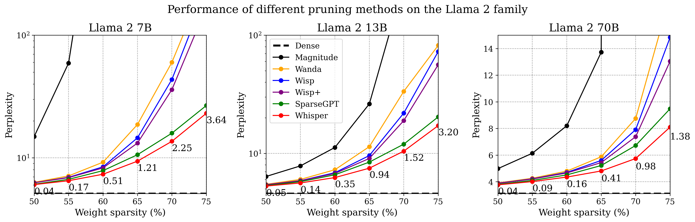
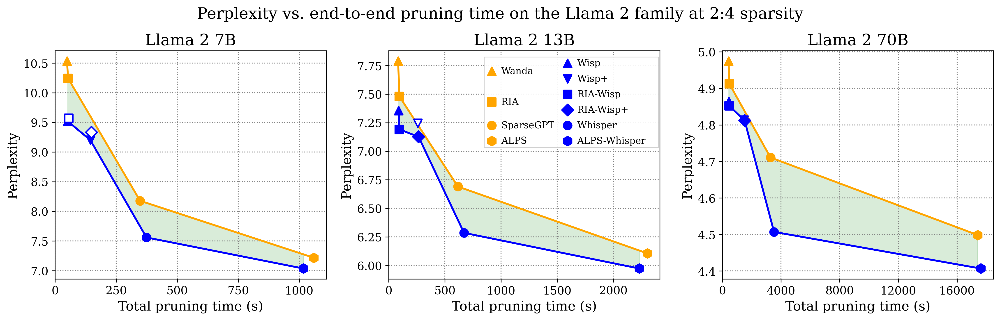

# ['The Sparsity Whisperer']()
Here we include the code for the official implementations of Wisp, Wisp+, and Whisper for our paper [The Sparsity Whisperer]().

### Overview



Unstructured sparsity scaling on Llama 2. Perplexity is shown for Llama 2 7B, 13B, and 70B as unstructured sparsity increases from 50% to 75% (lower is better). Wisp and Wisp+ consistently improve over Wanda in the no-update setting, while Whisper improves over SparseGPT at every sparsity and model size. The gains grow as pruning becomes more aggressive, suggesting that preserving pairwise output differences becomes increasingly important at high sparsity. Numbers written next to values indicate absolute perplexity improvement of Whisper over SparseGPT.

### Environment setup

Create a conda environment (installs PyTorch, torchvision, and all Python dependencies):
```
conda env create -f environment.yml
conda activate whisper
```

For a pip-only install, install PyTorch matching your CUDA version (see [pytorch.org](https://pytorch.org)), then:
```
pip install -r requirements.txt
```

### Running the examples

### Results



Difference-informed pruning shifts the accuracy-runtime frontier outward. Perplexity vs. end-to-end pruning time is shown for the Llama 2 family at 2:4 sparsity (lower-left is better). Orange markers denote baseline pruning methods, while blue markers denote their difference-informed counterparts. Filled markers denote Pareto-efficient methods and hollow markers denote dominated methods. Lines connect Pareto-efficient points within each group, and the shaded region highlights the improvement in attainable accuracy-runtime tradeoffs. Results collected over three trials.

### Cite
If you found our work useful, please cite our paper: